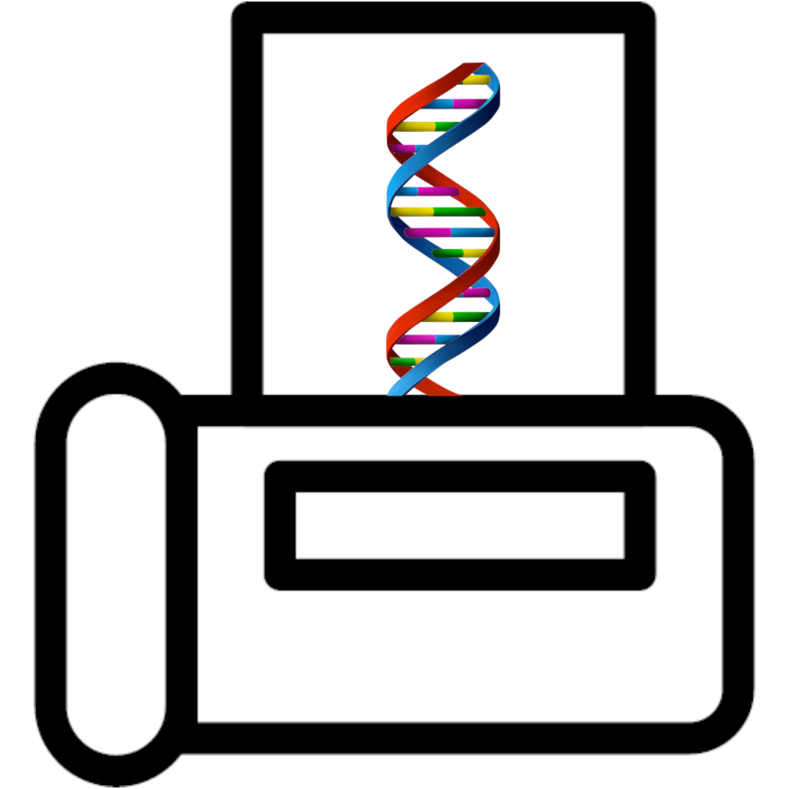

# vaximile



**Neoantigen prediction from tumor/normal DNA and tumor RNA sequencing.**

[](https://www.nextflow.io/)

vaximile takes a patient's tumor and matched normal exomes or genomes, plus tumor RNA-seq,
and predicts neoantigens with pVACseq and pVACfuse. Along the way it calls somatic and
germline variants, types HLA, checks for HLA loss, estimates copy number, quantifies
expression and calls fusions, and collects QC into one MultiQC report per patient.

## Steps

**DNA preprocessing.** [fastp](https://github.com/OpenGene/fastp) trimming,
[minibwa](https://github.com/lh3/minibwa) alignment, duplicate marking and GATK base
recalibration.

**Somatic variants.** [Mutect2](https://gatk.broadinstitute.org),
[Strelka2](https://github.com/Illumina/strelka) (with [Manta](https://github.com/Illumina/manta)
indel candidates) and [DeepSomatic](https://github.com/google/deepsomatic). A variant is kept
when at least two of the three call it, then filtered to those below 0.1% in every population.

**Germline variants.** GATK HaplotypeCaller with CNN filtering, Strelka2 and
[DeepVariant](https://github.com/google/deepvariant), with the same two-of-three rule. The
result is used to phase nearby variants for pVACseq.

**HLA typing.** [OptiType](https://github.com/FRED-2/OptiType) for class I and
[HLA-HD](https://www.genome.med.kyoto-u.ac.jp/HLA-HD/) for class II, on every DNA library.
pVACtools uses the normal's alleles, unless you give your own with `--hla_overrides`.

**Copy number.** [ASCAT](https://github.com/VanLoo-lab/ascat), which also estimates the purity
and ploidy used for HLA LOH.

**HLA LOH.** [mhcflow](https://github.com/svm-zhang/mhcflow) builds an HLA reference from each
normal, the tumor is realigned to it, and [lohhla-mod](https://github.com/svm-zhang/lohhla-mod)
calls loss. mhcflow needs Novoalign, which you supply with `--novoalign_dir`; without it this
step is skipped.

**RNA.** [STAR](https://github.com/alexdobin/STAR) alignment,
[salmon](https://combine-lab.github.io/salmon/) quantification, and fusions from
[Arriba](https://github.com/suhrig/arriba) and
[STAR-Fusion](https://github.com/STAR-Fusion/STAR-Fusion).

**Neoantigens.** [VEP](https://www.ensembl.org/vep) annotation with DNA and RNA coverage and
expression, then [pVACseq](https://pvactools.readthedocs.io) on somatic variants and pVACfuse
on fusions, for class I and class II.

**QC.** samtools, [mosdepth](https://github.com/brentp/mosdepth) capture coverage, Picard
oxidation and artifact metrics, [somalier](https://github.com/brentp/somalier) relatedness,
and somatic and germline variant QC, all in one [MultiQC](https://multiqc.info/) report per
patient.

## Quick start

```bash
nextflow run vaximile.nf -profile singularity,conda --samplesheet samplesheet.csv --capture_kits capture_kits.csv --outdir vaximile_out -resume
```

Some modules are container-only and some conda-only, so enable both. On UCSF's C4 cluster,
use `-profile ucsf` instead.

## Parameters

### Input/output options

Input samplesheets and output directory.

| Parameter | Description | Default |
| --------- | ----------- | ------- |
| `--samplesheet` | **Required.** CSV of patients, samples and FASTQs. | — |
| `--capture_kits` | **Required.** CSV mapping capture kit names to target BEDs. | — |
| `--hla_overrides` | CSV of somatic_name and alleles, replacing the typed HLA alleles for those pairs. See [HLA overrides](#hla-overrides). | — |
| `--outdir` | **Required.** Output directory. | `./vaximile_out` |

### Reference genome options

Reference genome, annotation, transcriptome and proteome.

| Parameter | Description | Default |
| --------- | ----------- | ------- |
| `--reference_fa` | Reference genome FASTA, plain or gzipped. | `https://ftp.ebi.ac.uk/pub/databases/gencode/Gencode_human/release_49/GRCh38.primary_assembly.genome.fa.gz` |
| `--reference_includes_chr_prefix` | Whether the reference contigs are named with 'chr'. | `true` |
| `--gtf` | Gene annotation GTF for RNA alignment, quantification and fusion calling. | `https://ftp.ebi.ac.uk/pub/databases/gencode/Gencode_human/release_49/gencode.v49.annotation.gtf.gz` |
| `--transcriptome_reference` | Transcriptome FASTA for the salmon index. | `https://ftp.ensembl.org/pub/release-115/fasta/homo_sapiens/cdna/Homo_sapiens.GRCh38.cdna.all.fa.gz` |
| `--human_ref_peptides` | Reference proteome FASTA for pVACtools' proteome similarity check. | `https://ftp.ensembl.org/pub/release-115/fasta/homo_sapiens/pep/Homo_sapiens.GRCh38.pep.all.fa.gz` |

### Alignment index options

Prebuilt indexes. Any left unset are built and saved to `./vaximile_resources/`.

| Parameter | Description | Default |
| --------- | ----------- | ------- |
| `--bwa_index` | Prebuilt minibwa index directory. | — |
| `--star_index` | Prebuilt STAR index directory. | — |
| `--salmon_index` | Prebuilt salmon index directory. | — |

### Downloaded resource options

Downloaded once into `./vaximile_resources/` when not given, and reused on later runs. Each default is the download it makes; see [Saved resources](#saved-resources) for where each one goes.

| Parameter | Description | Default |
| --------- | ----------- | ------- |
| `--vep_cache` | Ensembl VEP cache directory, release 115. | Downloads `https://ftp.ensembl.org/pub/release-115/variation/indexed_vep_cache/homo_sapiens_vep_115_GRCh38.tar.gz` |
| `--vep_plugins` | Directory with pVACtools' `Frameshift.pm` and `Wildtype.pm` VEP plugins. | Downloads both plugins from `https://github.com/griffithlab/pVACtools/tree/v7.1.5/pvactools/tools/pvacseq/VEP_plugins` |
| `--ctat_resource_lib` | STAR-Fusion CTAT library: the `ctat_genome_lib_build_dir` of a plug-n-play bundle. | Downloads `https://data.broadinstitute.org/Trinity/CTAT_RESOURCE_LIB/GRCh38_gencode_v44_CTAT_lib_Oct292023.plug-n-play.tar.gz` |
| `--arriba_blacklist` | Arriba blacklist. | `blacklist_hg38_GRCh38_v2.5.1.tsv.gz` from `https://github.com/suhrig/arriba/releases/download/v2.5.1/arriba_v2.5.1.tar.gz` |
| `--arriba_known_fusions` | Arriba known fusions. | `known_fusions_hg38_GRCh38_v2.5.1.tsv.gz` from the same release |
| `--arriba_protein_domains` | Arriba protein domains GFF3. | `protein_domains_hg38_GRCh38_v2.5.1.gff3` from the same release |
| `--ascat_resources` | ASCAT 1000 Genomes resource directory, laid out as the pipeline saves it. | Downloads the four 1000G WGS hg38 archives from `https://zenodo.org/records/14008443`, adding a `chr` prefix to the loci when `--reference_includes_chr_prefix` is set |

### Variant calling options

Interval scattering for the GATK callers.

| Parameter | Description | Default |
| --------- | ----------- | ------- |
| `--interval_padding` | Bases of padding around each calling interval. | `100` |
| `--scatter_count` | Number of interval shards for variant calling. | `30` |

### HLA LOH options

Used only for HLA LOH; HLA typing needs none of them.

| Parameter | Description | Default |
| --------- | ----------- | ------- |
| `--hla_fasta` | Polysolver HLA class I reference FASTA. | `https://raw.githubusercontent.com/jason-weirather/hla-polysolver/9326ac2ef9b112b9bc5f25222854296097b58be5/data/abc_complete.fasta` |
| `--hla_fasta_fai` | Index of the HLA reference FASTA. | `https://raw.githubusercontent.com/jason-weirather/hla-polysolver/9326ac2ef9b112b9bc5f25222854296097b58be5/data/abc_complete.fasta.fai` |
| `--hla_kmers` | Polysolver unique HLA k-mer file. | `https://raw.githubusercontent.com/jason-weirather/hla-polysolver/9326ac2ef9b112b9bc5f25222854296097b58be5/data/abc_v14.uniq` |
| `--hla_freq` | Polysolver HLA allele frequency table. | `https://raw.githubusercontent.com/jason-weirather/hla-polysolver/9326ac2ef9b112b9bc5f25222854296097b58be5/data/HLA_FREQ.txt` |
| `--novoalign_dir` | Directory with the `novoalign` and `novoindex` binaries. **HLA LOH is skipped without it.** Novoalign is no longer on bioconda; download it from [Novocraft](https://www.novocraft.com/support/download/). V4 also needs `novoalign.lic` in the same directory. | — |

### GATK resource bundle options

GATK resource VCFs. Each needs a matching .tbi.

| Parameter | Description | Default |
| --------- | ----------- | ------- |
| `--common_germline` | Common germline SNPs for contamination estimation. | `gs://gatk-best-practices/somatic-hg38/small_exac_common_3.hg38.vcf.gz` |
| `--known_sites_dbsnp` | dbSNP, known sites for BQSR. | `gs://gcp-public-data--broad-references/hg38/v0/Homo_sapiens_assembly38.dbsnp138.vcf.gz` |
| `--known_sites_1000g_snps` | 1000 Genomes high-confidence SNPs, known sites for BQSR. | `gs://gcp-public-data--broad-references/hg38/v0/1000G_phase1.snps.high_confidence.hg38.vcf.gz` |
| `--known_indels` | Known indels for BQSR. | `gs://gcp-public-data--broad-references/hg38/v0/Homo_sapiens_assembly38.known_indels.vcf.gz` |
| `--gnomad` | gnomAD allele frequencies for Mutect2. | `gs://gatk-best-practices/somatic-hg38/af-only-gnomad.hg38.vcf.gz` |
| `--pon` | Panel of normals for Mutect2. | `gs://gatk-best-practices/somatic-hg38/1000g_pon.hg38.vcf.gz` |
| `--hapmap` | HapMap SNPs, a truth set for germline CNN filtering. | `gs://gcp-public-data--broad-references/hg38/v0/hapmap_3.3.hg38.vcf.gz` |
| `--mills` | Mills gold standard indels, for BQSR and germline CNN filtering. | `gs://gcp-public-data--broad-references/hg38/v0/Mills_and_1000G_gold_standard.indels.hg38.vcf.gz` |
| `--somalier_sites` | Sites for somalier's relatedness check. | `https://github.com/brentp/somalier/files/3412456/sites.hg38.vcf.gz` |

### Generic options

Rarely changed options.

| Parameter | Description | Default |
| --------- | ----------- | ------- |
| `--publish_dir_mode` | How results are saved to the output directory. | `copy` |
| `--help` | Show this help. | `false` |

### Samplesheet

One row per library. Each tumor/normal pair (`somatic_name`) needs a tumor DNA, normal DNA
and tumor RNA row. A normal shared by several tumors gets a row in each pair and is
processed once.

| Column | Description |
| ------ | ----------- |
| `patient` | Patient ID. Pairs from the same patient share one MultiQC report. |
| `somatic_name` | Tumor/normal pair ID. |
| `sample_name` | Library's sample name. |
| `sample_type` | `Tumor` or `Normal`. |
| `sequencing_type` | `exome`, `genome`, `rna`, `exome_FFPE` or `genome_FFPE`. |
| `sex` | `XX`, `XY` or blank. Used by ASCAT. |
| `capture_kit` | Kit name from `capture_kits.csv`. Blank for RNA. |
| `fastqr1`, `fastqr2` | Paired FASTQs. |

`samplesheet.csv`

| patient  | somatic_name   | sample_name | sample_type | sequencing_type | sex | capture_kit | fastqr1         | fastqr2         |
| -------- | -------------- | ----------- | ----------- | --------------- | --- | ----------- | --------------- | --------------- |
| PatientX | PatientX_T1_N1 | Tumor1      | Tumor       | exome           | XX  | twist_2     | t1_r1.fq.gz     | t1_r2.fq.gz     |
| PatientX | PatientX_T1_N1 | Normal1     | Normal      | exome           | XX  | twist_2     | n1_r1.fq.gz     | n1_r2.fq.gz     |
| PatientX | PatientX_T1_N1 | Tumor1      | Tumor       | rna             | XX  |             | t1_rna_r1.fq.gz | t1_rna_r2.fq.gz |

`capture_kits.csv`

| kit     | bed                             |
| ------- | ------------------------------- |
| twist_2 | /beds/TwistExome_GRCh38_chr.bed |

### HLA overrides

`--hla_overrides` swaps in your own alleles for chosen pairs, e.g. from clinical typing. The
list replaces both classes for that pair and uses pVACtools' naming: `HLA-A*02:01` for class I,
`DRB1*15:01` for class II. Other pairs keep the typed alleles.

```csv
somatic_name,alleles
PatientX_T1_N1,"HLA-A*02:01,HLA-A*24:02,HLA-B*15:01,HLA-B*44:02,HLA-C*07:02,DRB1*15:01,DQA1*01:02,DQB1*06:02"
```

## Output

Each patient's results go in `<outdir>/<patient>/`.

```text
<outdir>/
└── <patient>/
    ├── <patient>_report.html          MultiQC report
    ├── <patient>_pvacseq_mhc_i_reports.tsv   pVACseq class I reports for all of the patient's pairs
    ├── <patient>_pvacseq_mhc_ii_reports.tsv  the same for class II
    ├── somatic_samples/
    │   └── <somatic_name>/
    │       ├── somatic/               somatic VCF and table
    │       ├── neoantigen_prediction/ pVACseq and pVACfuse output
    │       ├── hla_loh/               lohhla-mod results and plots
    │       └── CNV/ascat/             ASCAT results
    └── samples/
        └── <sample_name>/
            ├── alignment/             duplicate-marked, recalibrated and STAR BAMs
            ├── germline/              germline VCF and table (normals)
            ├── hla_typing/            OptiType and HLA-HD calls, and the pVACtools allele list
            └── salmon/                gene TPMs (RNA)
```

- **`<patient>_pvacseq_mhc_i_reports.tsv`** and **`_mhc_ii_reports.tsv`** join each pair's
  pVACseq aggregated report for that class, ranked by tier, with every sample's allelic depth.
  The class I report also has pVACseq's ML call (`ML Prediction (score)`, e.g. `Accept (0.71)`)
  next to the tier when the classifier runs.
- **The MultiQC report** covers read, alignment and coverage QC, library damage, sample
  relatedness, somatic and germline variant QC, HLA alleles and LOH, copy number and pVACseq
  results. Check the somalier tables first: each pair's tumor and normal should be related.
  The report ends with the launch command and every parameter used.
- **`alignment/`** has `_markdup.bam`, `_bqsr.bam` and, for RNA, `_STAR_sorted.bam`. Mutect2 and
  HaplotypeCaller use the recalibrated BAMs; Strelka, DeepSomatic and DeepVariant the
  duplicate-marked ones.
- **`salmon/`** has `<sample>_RNA.gene_tpm.tsv`, salmon's gene-level `quant.genes.sf`.

Per-caller VCFs, fusion tables and transcript-level salmon output stay in the work directory.
To publish them, add them to `publish:` and `output {}` in `vaximile.nf`.

### Saved resources

Downloads and built indexes go to `vaximile_resources/` in the launch directory, so later
runs from there reuse them. From elsewhere, point to them with these parameters:

```text
vaximile_resources/
├── vep_cache/vep_cache/                --vep_cache
├── vep_pvac_plugins/VEP_plugins/       --vep_plugins
├── ctat_resource_dir/GRCh38_gencode_v44_CTAT_lib_Oct292023.plug-n-play/
│   └── ctat_genome_lib_build_dir/      --ctat_resource_lib
├── arriba_hg38/arriba_v2.5.1/database/ --arriba_blacklist, --arriba_known_fusions, --arriba_protein_domains
├── ascat_hg38_chr/                     --ascat_resources (ascat_hg38_nochr without the chr prefix)
├── bwa_index/                          --bwa_index
├── star_index/STARGenomeDir/           --star_index
└── salmon_index/<name>_salmon_index/   --salmon_index
```

## Credits

vaximile is developed by Harrison Wismer at UCSF.

## Citations

Tool references are collected in [CITATIONS.md](CITATIONS.md).
